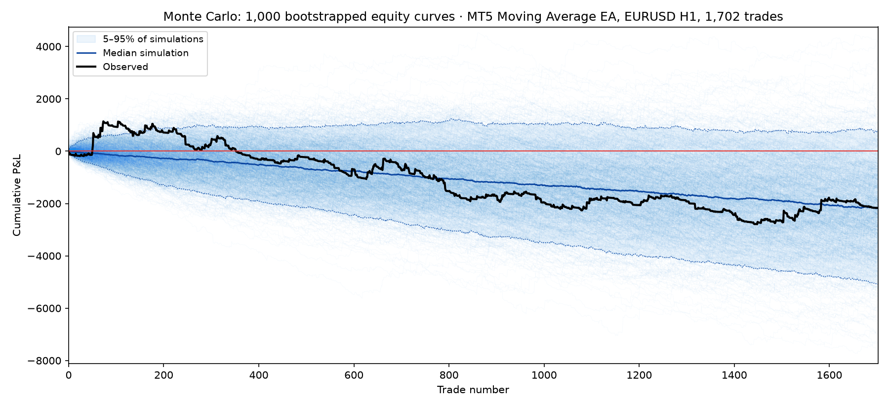
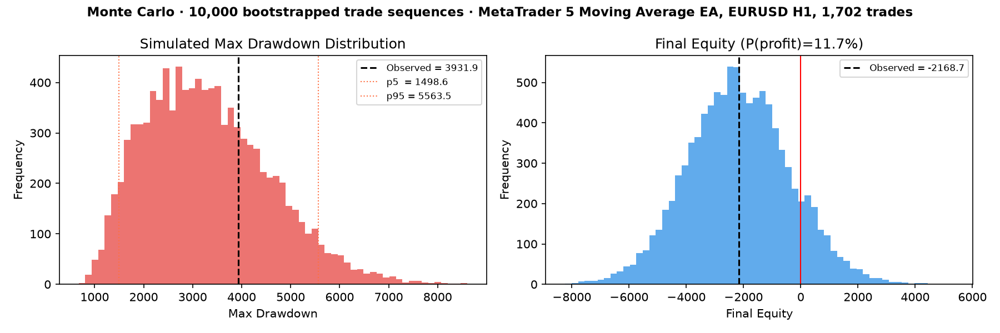
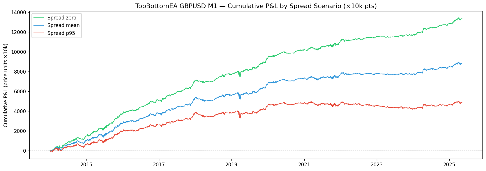
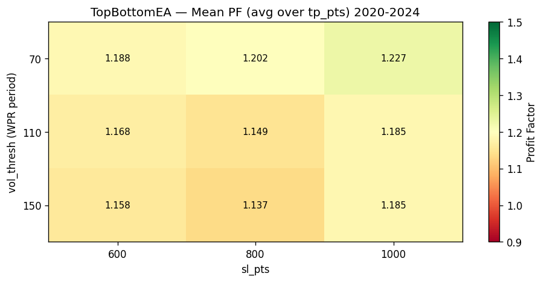
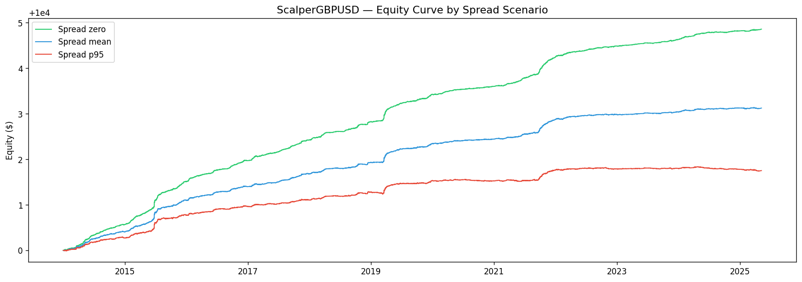

# ea-validator

[](https://github.com/sergiomeneguzzo/EA-Validator/actions/workflows/tests.yml)

A Python workbench for MetaTrader 5 Expert Advisor developers.

Test your EA logic in Python before going live — backtest, validate, filter by market regime, manage multi-EA risk.
Includes a ready-to-use MQL5 infrastructure (SignalBus + MasterRiskManager) you can drop into any MT5 project.

---

## What's inside

| Module | What it does |
|--------|-------------|
| **Backtest engines** | Bar-close, pending orders (BuyStop/SellStop), tick-level |
| **Validation scorecard** | 5 independent tests — one verdict: green / yellow / red |
| **Regime detector** | ADX-based, aligned bar-for-bar with MT5 output |
| **HMM detector** | 3-state hidden Markov model (bull / range / crisis) |
| **HRP allocator** | Hierarchical Risk Parity for multi-strategy portfolios |
| **Risk tools** | Vol targeting, drawdown controller, correlation monitor |
| **MT5 importer** | Converts MT5 CSV exports (OHLCV or Tick) to Parquet |
| **SignalBus** | MQL5 GlobalVar bus — your EA writes signals, MRM executes |
| **MasterRiskManager** | Sizes lots, applies vol scaling, manages all positions |

---

## Why test in Python instead of MT5 Strategy Tester

MT5's tester is great for a final sanity check, but slow for iteration — recompile, wait, click through dialogs, one result at a time. In Python you can:

- Run hundreds of parameter combinations in a loop in seconds
- Plot equity curves and drawdown immediately
- Run cross-validation and Monte Carlo without leaving a notebook
- Check whether your edge survives out-of-sample data before touching the live account

---

## Setup

```bash
git clone https://github.com/sergiomeneguzzo/EA-Validator
cd EA-Validator
uv sync          # or: pip install -e .
```

Requires Python 3.11+

---

## Getting data

Export from MT5 via **Instruments → History Center → Export** (CSV).
Drop the file in `data/raw/`, then run:

```bash
uv run python scripts/import_data.py
# → data/processed/SYMBOL_TIMEFRAME.parquet
```

Supports both OHLCV and Tick CSV formats. Handles tab/comma separators, both `<DATE>` and plain `date` column headers.

---

## Backtest your signal

Open `scripts/run_backtest.py`, drop your signal in:

```python
signal = your_strategy.generate_signal(df)   # pd.Series: 1 long, -1 short, 0 flat
```

```bash
uv run python scripts/run_backtest.py --parquet data/processed/SYMBOL_TIMEFRAME.parquet
```

```
────────────────────────────────────────
  Trades   : 312
  PF       : 1.48
  Sharpe   : 1.21
  Max DD   : 11.3%
  Win Rate : 54.2%
  End Eq   : 14,820.00
────────────────────────────────────────
```

Or use the engine directly:

```python
from quant.backtest.engine import run_backtest

result = run_backtest(df, signal, sl_prices=sl, initial_capital=10_000.0)
m = result["metrics"]   # profit_factor, sharpe, max_dd, win_rate, n_trades
eq = result["equity_curve"]
```

Three engines available:

```python
from quant.backtest.engine         import run_backtest          # bar-close
from quant.backtest.pending_engine import run_scalper_backtest  # BuyStop/SellStop + trailing
from quant.backtest.tick_engine    import TickBacktestEngine    # tick-level
```

---

## Validate your edge

A good-looking backtest is not enough. Run 5 independent checks (the script uses the bundled
`sma_cross` example: swap in your own strategy function):

```bash
uv run python scripts/run_validation.py --parquet data/processed/EURUSD_H1.parquet --fast 20 --slow 50 --trials 10
```

```
Verdict: GREEN  (4/5 tests passed)

  ✓  purged_cv
  ✓  deflated_sr
  ✓  monte_carlo
  ✗  robustness
  ✓  walk_forward
```

| Test | What it catches |
|------|----------------|
| **Purged CV** | Overfitting from data leakage between folds |
| **Deflated Sharpe** | Sharpe inflated by running too many parameter trials (per-period SR, Bailey & López de Prado) |
| **Monte Carlo** | Bootstrap of your trades: probability of ending in profit and worst-case drawdown |
| **Robustness** | Parameters that work only at one exact value (±20% sensitivity) |
| **Walk-Forward** | Performance decay from in-sample to out-of-sample (60/20/20 split) |

Or use the scorecard directly in code. A strategy is any function `(df, params) -> signal`:

```python
from quant.strategies import sma_cross
from quant.validation.scorecard import StrategyScorecard, ScorecardConfig

card = StrategyScorecard(ScorecardConfig()).evaluate(
    "sma_cross", sma_cross, df, {"fast": 20, "slow": 50}, n_trials=10,
)
print(card["overall_status"])          # "green" / "yellow" / "red"
print(card["monte_carlo"]["p_profitable"], card["deflated_sr"]["p_value"])
```

**Monte Carlo on real trades.** 1,702 trades from an MT5 backtest, resampled 10,000 times. The observed result
looks like a moderate loss, but the bootstrap shows that the strategy ends in profit in only 11.7% of the
alternative histories, and that a drawdown up to 40% larger than the observed one is entirely plausible.

```python
from quant.validation import mc_bootstrap_test, plot_mc_distributions, plot_mc_equity_paths

plot_mc_equity_paths(trade_pnl, n_simulations=1_000, path="monte_carlo_paths.png")
mc = mc_bootstrap_test(trade_pnl, n_simulations=10_000)
plot_mc_distributions(mc, path="monte_carlo.png")
```









---

## Regime filter

The ADX regime detector is a direct Python replica of MT5's `iADX` — same Wilder smoothing, same thresholds, results align bar-for-bar with the terminal.

```python
from quant.regime.adx_regime import AdxRegimeDetector, TREND_UP, TREND_DOWN, RANGING, VOLATILE

regime = AdxRegimeDetector(adx_period=14, adx_threshold=25).detect(df)

# only take entries in trending conditions
signal[regime == RANGING] = 0
```

Or use the Gaussian HMM for a probabilistic approach:

```python
from quant.regime.hmm_detector import HMMRegimeDetector

hmm = HMMRegimeDetector(n_states=3).fit(df)
regime = hmm.predict_dominant(df)   # "bull" / "range" / "crisis"
```

---

## MQL5 — SignalBus & MasterRiskManager

If you run multiple EAs on the same account, `MasterRiskManager` centralises lot sizing, vol targeting, and position management. Your EAs stay simple — they just publish signals.

**Add 2 lines to your strategy EA:**

```mql5
#include "PortfolioEA/Core/SignalBus.mqh"

// entry condition fires → publish signal
SignalWrite(_Symbol, "MyStrategy", direction, 0, sl_pips, tp_pips);
// 1 = BUY, -1 = SELL

// exit condition fires → clear signal (MRM closes the position)
SignalClear(_Symbol, "MyStrategy");
```

**Attach `MasterRiskManager.mq5` to any chart.** It runs on every tick:

1. Reads all active signals from Global Variables
2. Sizes lots — `equity × risk% ÷ (sl_pts × tick_value) × vol_scale`
3. Opens the position with SL / TP
4. Closes when the signal is cleared

Key inputs:

| Input | Default | Description |
|-------|---------|-------------|
| `InpVolTarget` | 0.20 | Annualised vol target (scales lot sizes up/down) |
| `InpVolLookbackDays` | 60 | Days of equity history for vol estimate |
| `InpDefaultRisk` | 1.0 | % equity risked per trade |
| `InpKillSwitch` | false | Set true to close all managed positions immediately |

Vol scaling: quiet market → bigger lots, volatile market → smaller lots, clamped to [0.20×, 3.00×]. Needs at least 30 days of history to activate; defaults to 1.0× until then.



---

## Portfolio tools

```python
from quant.portfolio.hrp import HRPAllocator

# allocate across strategies by Hierarchical Risk Parity
weights = HRPAllocator().compute_weights(returns_df)
weights = HRPAllocator().compute_weights_with_constraints(returns_df, min_weight=0.05, max_weight=0.40)
```

```python
from quant.risk.vol_targeting     import VolTargeter
from quant.risk.drawdown_controller import DrawdownController

scale = VolTargeter(target_vol_annual=0.20, lookback_days=60).compute_scaling(equity)
scale = DrawdownController([(0.05, 1.0), (0.10, 0.5), (0.15, 0.0)]).compute_scale(equity)
```

---

## Project structure

```
ea-validator/
├── src/quant/
│   ├── backtest/           bar-close, pending orders, tick engines
│   ├── validation/         scorecard, purged CV, Monte Carlo, walk-forward
│   ├── regime/             ADX detector, HMM detector
│   ├── portfolio/          HRP allocator
│   ├── risk/               vol targeting, drawdown controller, correlation monitor
│   ├── strategies/         ← implement yours here
│   └── data/               MT5 CSV → Parquet importer
├── mql5/
│   └── PortfolioEA/
│       ├── MasterRiskManager.mq5
│       └── Core/
│           ├── SignalBus.mqh
│           └── RiskManager.mqh
├── scripts/
│   ├── import_data.py
│   ├── run_backtest.py
│   └── run_validation.py
├── configs/
│   └── strategy_template.yaml
└── tests/
```

---

## Tests

```bash
uv run pytest tests/ -v
```

---

## License

[MIT](LICENSE)
